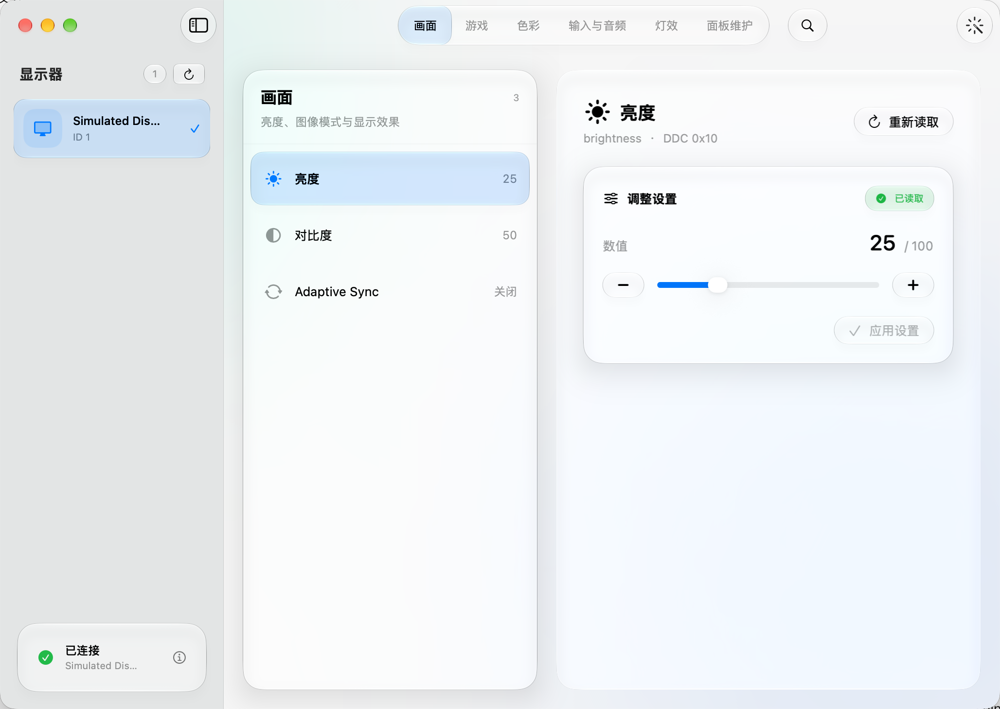
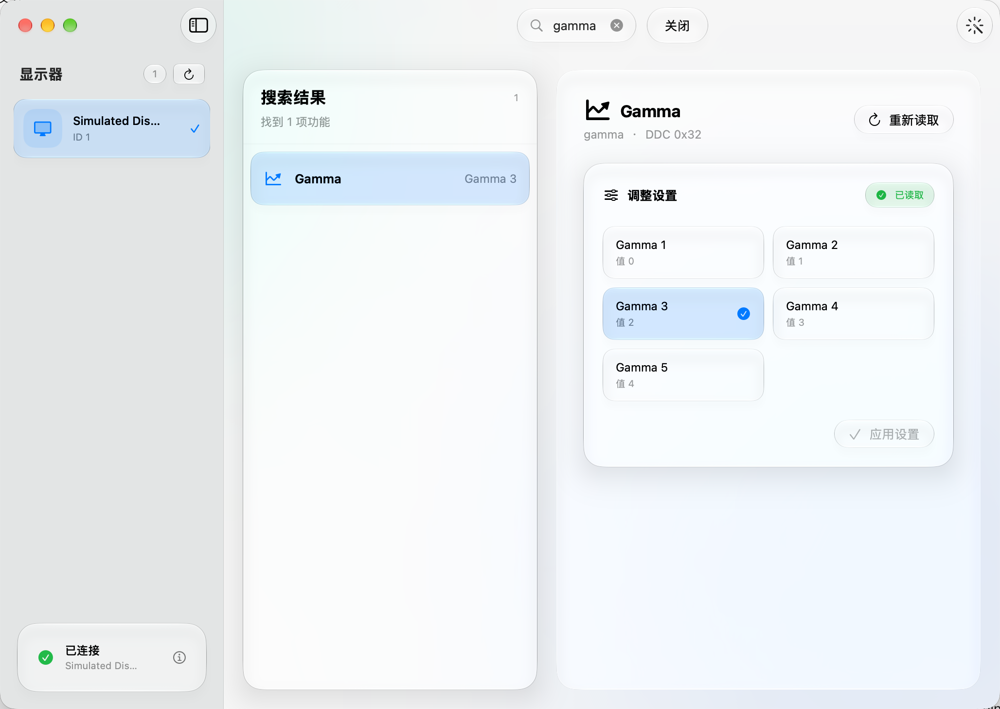
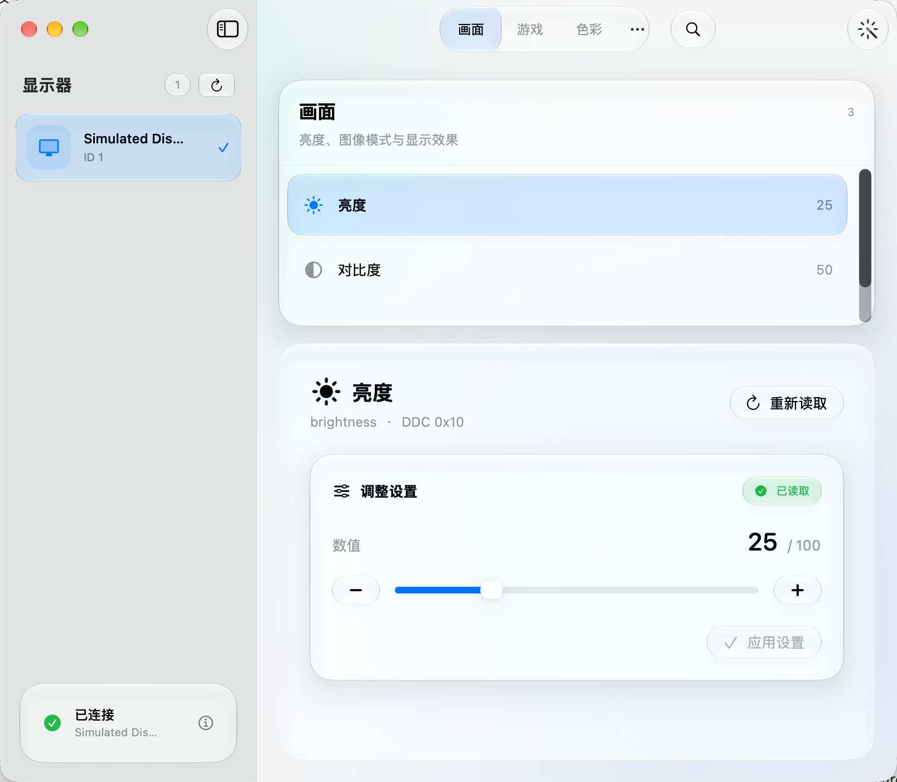

<div align="center">
  
  <h1>AmarokOSD</h1>
</div>

AmarokOSD 是一款 macOS 应用程序，用于读取和调整 AOC／AGON 显示器的 OSD（屏幕显示菜单）设置。

## 界面预览

以下截图使用 `-SimulatedUI` 启动参数和模拟显示器数据生成。

**主界面：显示器列表、分类功能和亮度控制**



**功能搜索：查找 Gamma 并选择参数值**



**窄窗口布局：功能列表与设置详情上下排列**



## 适用范围

本程序仅适用于 AOC／AGON 显示器，与通用 DDC/CI 控制器属于不同类型的工具。其他品牌显示器需要采用符合其设备协议的控制软件。DDC/CI 仅承担命令传输，实际功能由显示器的 OSD 功能定义和扩展命令决定。各型号提供的功能存在差异，具体支持情况以设备型号、固件版本和连接方式为准。

## 运行条件

- 使用 Apple 芯片的 Mac。
- macOS 14.0 或更高版本。
- AOC／AGON 外接显示器，并已在显示器 OSD 菜单中开启 DDC/CI。
- 能够传输 DDC/CI 信号的视频线及连接方式。

部分扩展坞、转接器、KVM 和视频线可能阻断 DDC/CI 通信。遇到连接问题时，可将显示器直接连接到 Mac 后再试。

## 主要功能

- 查找已连接的显示器，并在多台显示器之间切换。
- 检测当前显示器可读取和调整的 OSD 项目。
- 按画面、游戏、色彩、输入与音频、灯效、面板维护等类别浏览设置。
- 按功能名称或 DDC 地址搜索设置。
- 读取当前值，修改设置，并在写入后读取显示器返回的结果。
- 重新查找显示器、重新检测功能，或取消正在进行的功能检测。

## 从源码构建

构建环境需要安装 Xcode，以及 Rust 1.85 或更高版本。项目通过 Git 子模块包含 `agon-ctl`，Xcode 构建阶段会编译其 FFI 库。

在项目目录执行：

```bash
git submodule update --init --recursive
open AmarokOSD.xcodeproj
```

在 Xcode 中选择 `AmarokOSD` 方案，然后构建并运行。

## 使用方法

1. 打开显示器，确认 Mac 已正常输出画面，并在显示器 OSD 菜单中开启 DDC/CI。
2. 启动 AmarokOSD，等待显示器查找和功能检测完成。
3. 连接多台显示器时，在左侧列表中选择需要操作的设备。
4. 通过分类标签或搜索框找到需要调整的设置。
5. 打开设置项，点击“重新读取”取得当前值。完成调整后点击“应用设置”，并核对程序显示的回读结果。

常用操作如下：

| 操作 | 方法 |
| --- | --- |
| 重新查找显示器 | 点击工具栏“刷新”，或按 `Command + R` |
| 重新检测当前显示器的全部功能 | 点击工具栏“探测全部” |
| 停止功能检测 | 点击“取消探测” |
| 重新读取某一项设置 | 打开该设置项，点击“重新读取” |
| 查看程序版本 | 打开菜单栏“AmarokOSD → 关于 AmarokOSD” |

“刷新”针对设备列表，“探测全部”针对当前设备的功能列表。

## 操作注意

- 修改前可记录原值，以便需要时恢复。
- 切换输入源、改变图像模式或执行面板维护操作，可能导致画面短暂中断、黑屏或显示器重新启动。若画面持续中断，请使用显示器实体按键操作，并参阅显示器说明书。
- 写入或回读出现失败时，设置可能已经生效。重新读取当前值后，再判断后续操作。
- 避免让多个显示器控制程序同时访问同一台显示器。

## 连接与功能检查

显示器列表为空或功能列表缺少项目时，请检查以下事项：

1. 显示器已开机，Mac 能正常输出画面。
2. 显示器 OSD 菜单中的 DDC/CI 已开启。
3. 视频线和连接方式能够传输 DDC/CI 信号。
4. 已执行“刷新”或“探测全部”，并等待操作完成。

完成上述检查后问题仍然存在时，目标型号、固件或连接方式可能超出当前适配范围。DDC/CI 开关仅表示通信通道已启用，实际支持情况以 `agon-ctl` 对目标设备的适配结果为准。

## 通信组件

AmarokOSD 使用 [agon-ctl](https://github.com/CyberKoo/agon-ctl) 提供的 `agon-osd-ffi` 与显示器通信。该组件结合标准 VCP 命令与 AGON 扩展命令，实现 AOC／AGON 显示器的 OSD 控制，适用设备以 AOC／AGON 显示器为限。

## 许可证

AmarokOSD 采用 [BSD 3-Clause License](LICENSE)。第三方组件的许可证随其源代码一并提供。
